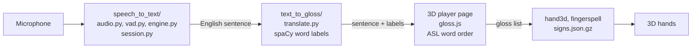

# Signify

Speak English, see it signed in ASL by 3D hands.

## Features

### Speech to Text
- Live speech recognition that works offline
- Live transcript
- Automatic sentence detection
- Start, pause, resume, and clear controls
- Export audio and transcript

### English to ASL
- ASL word order (gloss)
- Drops words ASL doesn't use
- Understands word forms
- Grammar analysis with spaCy
- Fingerspelling for words without a sign

### 3D signing
- 1973 ASL signs plus the alphabet A-Z
- Realistic 3D hand rendering
- Motion from real ASL signers
- Signs quality-checked against ASL-LEX database
- Smooth transitions between signs
- Playback controls and joints-only view

### Sign library and website
- Searchable sign library page
- Website version with microphone works on Chrome and Edge
- Typed input works in any browser

### Setup
- One-command setup
- No large downloads for signs

In the future planning to support ASL to speech

## How it works

It works in three steps, each in its own folder:

| Step | Folder | What it does |
| --- | --- | --- |
| 1 | `speech_to_text/` | Listens to the microphone and writes down what was said (vosk, offline) |
| 2 | `text_to_gloss/` | Labels and turns the English sentence into ASL gloss, the ASL word order |
| 3 | `gloss_to_asl/` | Plays each gloss word as a sign on 3D MakeHuman hands |



## Tech Stack

### Languages

| Tool | What it does | Why |
| --- | --- | --- |
| Python 3.11+ | Desktop app, speech pipeline, and sign-building tools | Main libraries built for python. Version 3.11 and newer run faster, allowing for live speech recognition. |
| JavaScript | 3D player, ASL word-order rules, website | Runs in the browser, so the desktop app and the website share the same player |

### Speech to text

| Tool | What it does | Why |
| --- | --- | --- |
| Vosk | Turns speech into text | Runs fully offline on a regular CPU. In our benchmark it was the fastest engine (3 ms partial results) and used the least memory, with accuracy matching Whisper base. See `speech_to_text/benchmark.md`. |
| Silero VAD | Detects speech vs. silence to know when a sentence ends | A small neural network that's more reliable than a simple volume threshold, so background noise doesn't cut sentences off or keep them open. |
| sounddevice | Records audio from the microphone | Simple, works on Windows, Mac and Linux, and hands audio straight to NumPy for processing. |

### Language analysis

| Tool | What it does | Why |
| --- | --- | --- |
| spaCy (`en_core_web_sm`) | Labels each word's part of speech, base form, and negation | Fast, runs offline, and its small English model is accurate enough to tell nouns from verbs and spot words like "not", which the ASL word-order rules depend on. |

### 3D signing

| Tool | What it does | Why |
| --- | --- | --- |
| Three.js | Draws and animates the 3D hands | The most widely used 3D library for the web. It supports skinned hand models with skeletons and runs in any modern browser. |
| MakeHuman hand model | 3D hand mesh, skeleton, and skin weights | Realistic and ready to animate, and free to use (CC0 license). |
| NumPy / SciPy | Joint rotations, motion smoothing, and solving thumb positions for fingerspelling | Fast math on large arrays of joint data. SciPy's optimizer finds thumb positions that reach the right spot for each letter. |

### App and website

| Tool | What it does | Why |
| --- | --- | --- |
| PySide6 (Qt) + Qt WebEngine | Desktop window, with the 3D player page shown inside it | The official Qt library for Python. It works on all major operating systems, and WebEngine lets the app reuse the web player instead of rebuilding it in Python. |
| GitHub Pages + GitHub Actions | Hosts the website and rebuilds it on every push to `main` | Free, and it serves over HTTPS, which browsers require before they'll allow microphone access. The workflow in `.github/workflows/deploy-pages.yml` builds the pages from the sign pack, so no video clips are needed. |

## Project Structure

```
signify/
├── main.py                  # Starts the desktop app
├── gui.py                   # Main window: buttons, live transcript, status bar
├── sign_panel.py            # Right panel: shows the 3D player and sends it each sentence
├── setup.py                 # One-command setup: venv, packages, speech model, sign pages
├── requirements.txt         # Python packages
│
├── models/                  # Created by setup.py, not in the repo
│   └── vosk/                # Vosk small English speech model (vosk-model-small-en-us-0.15)
│       ├── am/              # Acoustic model: turns audio into speech sounds
│       ├── conf/            # Audio settings (16 kHz input) and decoding settings
│       ├── graph/           # Vocabulary and grammar: turns sounds into words
│       ├── ivector/         # Adjusts to each speaker's voice
│       └── README           # Model info from Alpha Cephei (accuracy, speed)
│
├── venv/                    # Python virtual environment, created by setup.py, not in the repo
│
├── speech_to_text/          # Step 1: microphone to English text
│   ├── audio.py             # Records the microphone in small chunks, saves a WAV copy
│   ├── vad.py               # Silero voice detection: speech or silence?
│   ├── engine.py            # Vosk speech recognition (offline)
│   ├── session.py           # Runs step 1: partial text, sentence endings, pause, export
│   ├── postprocess.py       # Capitalizes and punctuates each sentence
│   └── benchmark.md         # Speech engine comparison (why we chose Vosk)
│
├── text_to_gloss/           # Step 2: English text to word labels
│   ├── translate.py         # Labels each word with spaCy (part of speech, base form, negation)
│   └── gloss.py             # Loads spaCy; also holds the first rule-based translator (prototype)
│
├── gloss_to_asl/            # Step 3: ASL gloss to 3D signing
│   ├── hand3d.py            # Turns tracked joints into 3D hand rotations
│   ├── fingerspell.py       # Builds A–Z hand shapes for fingerspelling
│   ├── aliases.py           # Maps word forms to signs ("going" to GO), words to drop
│   ├── library.py           # Packs the signs and builds the HTML player pages
│   ├── motion.py            # Data format for sign motion
│   ├── clips.py             # Data format for sign clips
│   ├── assets/
│   │   ├── signs.json.gz    # Motion for all 1,973 signs (joint data only, no video)
│   │   └── hand/
│   │       ├── player_tpl.html      # 3D hand player (Three.js)
│   │       ├── site_tpl.html        # Website mic page
│   │       ├── gloss.js             # English to ASL word-order rules
│   │       ├── makehuman_hand.json  # 3D hand model and skeleton
│   │       └── nouns.txt            # Noun list used by the word-order rules
│   │
│   │   # Offline tools: only used to rebuild the sign data
│   ├── setup_clips.py       # Downloads WLASL sign videos
│   ├── animate.py           # Tracks hands and arms in the videos with MediaPipe
│   ├── signcheck.py         # Checks tracked signs against ASL-LEX
│   ├── tools/               # One-off scripts (hand model, noun list, re-tracking)
│   ├── playlist.py          # Looks up signs or fingerspelling for the hand3d preview tool
│   │     
│   └── spec_step3.md        # First plan for step 3 (video-clip playback), replaced by 3D hands
│
├── exports/                 # Created by setup.py, not in the repo
│   └── library.html         # Player page shown inside the desktop app
│
├── .github/workflows/
│   └── deploy-pages.yml     # Builds web/ and deploys it to GitHub Pages on every push to main
│
└── web/                     # Website
    ├── index.html           # Mic page (built by setup.py, not in the repo)
    └── library.html         # Sign library page (built by setup.py, not in the repo)
```

## Requirements

**To run the desktop app**
- **Python 3.11 or newer** (tested on Python 3.14). Download it from python.org; on Windows, check "Add Python to PATH" during install.
- **Windows, macOS, or Linux** (tested on Windows)
- **A microphone**
- **Git** (to clone the repo); you can also download the ZIP from GitHub instead
- **About 2.5 GB of free disk space** (the installed packages take about 2 GB, and the speech model about 70 MB)
- **4 GB of RAM or more** (the speech model uses about 640 MB)
- **An internet connection:**
  - for the first setup, which downloads the packages and the Vosk model and takes a few minutes
  - while running, to load the 3D hands (Three.js loads from the web). Speech recognition itself works offline.

**To use the website**
- Chrome or Edge for the microphone button (it uses the browser's speech recognition)
- Any modern browser for typing sentences

**Only to rebuild the sign data** (`python setup.py --rebuild-signs`)
- Several hours, plus extra disk space for the WLASL videos
- Not needed to run Signify, since the sign motion is already in the repo

## Setup and run

```bash
git clone https://github.com/Signify5/Sign-app.git signify
```

```bash
cd signify
```

Windows:
```bash
python setup.py
```

Mac or Linux:
```bash
python3 setup.py
```

Windows:

```bash
venv\Scripts\python main.py
```

macOS / Linux:

```bash
venv/bin/python main.py
```

Press record, speak, and the 3D hands sign what you said.

## Troubleshooting

**`'python' is not recognized` (Windows)**
Python isn't on your PATH. Try `py setup.py` instead, or reinstall Python and check "Add Python to PATH".

**`Signify needs Python 3.11 or newer`**
Install Python 3.11 or newer from python.org, then run setup again.

**A package fails to install during setup**
Some packages (like MediaPipe) can lag behind the newest Python release. Try Python 3.11 or 3.12. On a school or work network, the download may also be blocked; try another network.

**`vosk model not found at 'models/vosk'`**
The speech model didn't download. Run `python setup.py` again. If the download keeps failing, download `vosk-model-small-en-us-0.15.zip` from https://alphacephei.com/vosk/models, unzip it into `models/`, and rename the folder to `vosk`.

**`could not open microphone`**
- Check that a microphone is plugged in and not muted.
- **Windows:** Settings → Privacy & security → Microphone → turn on "Let desktop apps access your microphone".
- **macOS:** System Settings → Privacy & Security → Microphone → allow your terminal app.

**Status says "Listening" but no words appear**
The app may be using the wrong microphone. Set the right one as the default input device in your system sound settings, then press Stop and Start.

**The hands panel says `The 3D hands need Qt WebEngine`**
Run `venv\Scripts\python -m pip install PySide6-Addons` (Windows) or `venv/bin/python -m pip install PySide6-Addons` (Mac/Linux).

**The hands panel says `No sign library yet`**
Build the player page: `venv\Scripts\python -m gloss_to_asl.library` (Windows) or `venv/bin/python -m gloss_to_asl.library` (Mac/Linux).

**The hands panel is blank**
The 3D player loads Three.js from the internet. Check your connection and restart the app.

**`running scripts is disabled on this system` (PowerShell)**
This only happens if you try to activate the venv. You don't need to; just use `venv\Scripts\python main.py`. To activate it anyway, first run:
```
Set-ExecutionPolicy -Scope Process -ExecutionPolicy RemoteSigned
```

**A word is spelled letter by letter instead of signed**
That word isn't one of the 1,973 signs, so Signify fingerspells it. This is expected.

**The website's mic button doesn't work**
Use Chrome or Edge, and allow microphone access when the browser asks. Typing a sentence works in any browser.

## Known limitations

**Translation**
- Translations are made by a rule-based program and have not been checked by a Deaf signer.
- The word-order rules handle simple sentences (statements, questions, negation, time words). More complex ASL grammar, like topic-comment structure, classifiers, and role shift, is not supported.
- Speech recognition doesn't produce punctuation, so spoken questions may not be recognized as questions. Typed questions with a "?" work better.

**Signing**
- Only the hands and arms are animated. ASL also uses facial expressions, head movement, and body position to carry grammar (for example, raised eyebrows for yes/no questions), and these are not shown.
- Signs are made in front of the body and don't use space to refer to people or places, so verbs that change direction (like GIVE or HELP) always look the same.
- The vocabulary is limited to 1,973 signs; any other word is fingerspelled.
- Sign motion was tracked from 2D videos, so some signs may be slightly off, especially where the hands overlap or touch the face. Signs that failed the ASL-LEX check are fingerspelled instead.
- Each sign comes from one signer's video, so regional and personal variations are not represented.

**Speech recognition**
- English only.
- Accuracy drops with background noise, strong accents, or fast speech. In our tests the small Vosk model got about 5.6% of words wrong.
- A sentence ends after about 0.9 seconds of silence, so a long pause in the middle splits it into two.

**Platform**
- Only goes one way: speech to ASL. ASL to speech is not supported yet.
- The 3D hands need an internet connection to load.
- The website's mic button sends audio to Google or Microsoft for recognition.
- Tested only on Windows.
- The code is GPL-3.0 (see `LICENSE`), but because of the WLASL data license, Signify's sign data is for non-commercial and academic use only.

## The website

Setup also builds a website in `web/`: a mic page, and a sign library page with every sign, the alphabet and some phrases. The signer opens in the cartoon style, and the "Style" button in the corner switches to the realistic one.

To try it on your computer:

```bash
venv\Scripts\python -m http.server 8000 --directory web
```

Then open http://localhost:8000 in **Chrome or Edge**.

- The mic button uses the browser's own speech recognition. It only works in Chrome and Edge, and it sends your voice to Google or Microsoft to turn it into text.
- Typing a sentence works in any browser.

### Hosting

The site is hosted on GitHub Pages and redeploys by itself every time something is pushed to `main`. It is public, with no password. Pages serves HTTPS, so the mic works.

To host your own copy:

1. Fork or push the repo to GitHub.
2. In the repo, open **Settings > Pages** and set **Source** to **GitHub Actions**. (The workflow also tries to turn this on the first time it runs.)
3. Push to `main`, or open the **Actions** tab, pick **Deploy GitHub Pages** and click **Run workflow**.
4. The site appears at `https://<your-user>.github.io/<repo>/` once the run turns green, usually in under a minute.

The workflow runs `python -m gloss_to_asl.library --from-pack --web web`, which builds the pages from `gloss_to_asl/assets/signs.json.gz`. To rebuild the same pages locally, run that command and serve `web/` as above. Any other static host (Netlify, Cloudflare Pages, S3) also works if you serve the contents of `web/` over HTTPS.

## Licenses and data: read before sharing

- **3D hands:** MakeHuman base mesh, skeleton and weights, CC0, free to use.
- **Sign motion:** tracked by this project from WLASL sign videos.
  - WLASL is shared under the Computational Use of Data Agreement (C-UDA 1.0), which puts no limits on Results, meaning things made from the data that don't contain it.
  - `signs.json.gz` holds only joint angles and positions, with no video frames, which is why it is in the repo.
  - WLASL asks for academic and non-commercial use only. Do not sell Signify or use it commercially.
  - The WLASL videos themselves (`datasets/`) and the full tracking output (`clips/`) stay out of git.
  - Credit: Li et al., "Word-level Deep Sign Language Recognition from Video", WACV 2020 (https://github.com/dxli94/WLASL).
- **Sign checking:** ASL-LEX, used for research.
- Translations are made by a program and have not been checked by a Deaf signer.

## Credits

**Team**
- Anika Prasad
- Vedant Daga
- Sumedh Malladi
- Rishita Gorle
- Netra Bhattad

**Co-designer**
Thank you to our co-designer for working with us throughout the project and testing Signify.

**Mentors and support**
- Ms. Krishnan, team coach
- The MIT Beaver Works CRE[AT]E Challenge for the course, mentorship[, and project funding]

**Data**
- WLASL: Li et al., "Word-level Deep Sign Language Recognition from Video", WACV 2020
- ASL-LEX: Caselli et al., "ASL-LEX: A lexical database of American Sign Language", Behavior Research Methods, 2017
- MakeHuman: 3D hand model (CC0)

**Open-source tools**
Vosk (Alpha Cephei), Silero VAD, spaCy, MediaPipe, Three.js, PySide6 (Qt), NumPy, SciPy, OpenCV