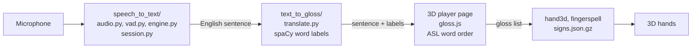

# Signify

Speak English, see it signed in ASL by 3D hands.

## Features

### Speech to Text
- Live speech recognition that works offline
- Live transcript
- Automatic sentence detection
- Start, pause, resume, and clear controls
- Export audio and transcript

### English to ASL
- ASL word order (gloss)
- Drops words ASL doesn't use
- Understands word forms
- Grammar analysis with spaCy
- Fingerspelling for words without a sign

### 3D signing
- 1973 ASL signs plus the alphabet A-Z
- Realistic 3D hand rendering
- Motion from real ASL signers
- Signs quality-checked against ASL-LEX database
- Smooth transitions between signs
- Playback controls and joints-only view

### Sign library and website
- Searchable sign library page
- Website version with microphone works on Chrome and Edge
- Typed input works in any browser

### Setup
- One-command setup
- No large downloads for signs

In the future planning to support ASL to speech

## How it works

It works in three steps, each in its own folder:

| Step | Folder | What it does |
| --- | --- | --- |
| 1 | `speech_to_text/` | Listens to the microphone and writes down what was said (vosk, offline) |
| 2 | `text_to_gloss/` | Labels and turns the English sentence into ASL gloss, the ASL word order |
| 3 | `gloss_to_asl/` | Plays each gloss word as a sign on 3D MakeHuman hands |



## Tech Stack

### Languages

| Tool | What it does | Why |
| --- | --- | --- |
| Python 3.11+ | Desktop app, speech pipeline, and sign-building tools | Main libraries built for python. Version 3.11 and newer run faster, allowing for live speech recognition. |
| JavaScript | 3D player, ASL word-order rules, website | Runs in the browser, so the desktop app and the website share the same player |

### Speech to text

| Tool | What it does | Why |
| --- | --- | --- |
| Vosk | Turns speech into text | Runs fully offline on a regular CPU. In our benchmark it was the fastest engine (3 ms partial results) and used the least memory, with accuracy matching Whisper base. See `speech_to_text/benchmark.md`. |
| Silero VAD | Detects speech vs. silence to know when a sentence ends | A small neural network that's more reliable than a simple volume threshold, so background noise doesn't cut sentences off or keep them open. |
| sounddevice | Records audio from the microphone | Simple, works on Windows, Mac and Linux, and hands audio straight to NumPy for processing. |

### Language analysis

| Tool | What it does | Why |
| --- | --- | --- |
| spaCy (`en_core_web_sm`) | Labels each word's part of speech, base form, and negation | Fast, runs offline, and its small English model is accurate enough to tell nouns from verbs and spot words like "not", which the ASL word-order rules depend on. |

### 3D signing

| Tool | What it does | Why |
| --- | --- | --- |
| Three.js | Draws and animates the 3D hands | The most widely used 3D library for the web. It supports skinned hand models with skeletons and runs in any modern browser. |
| MakeHuman hand model | 3D hand mesh, skeleton, and skin weights | Realistic and ready to animate, and free to use (CC0 license). |
| NumPy / SciPy | Joint rotations, motion smoothing, and solving thumb positions for fingerspelling | Fast math on large arrays of joint data. SciPy's optimizer finds thumb positions that reach the right spot for each letter. |

### App and website

| Tool | What it does | Why |
| --- | --- | --- |
| PySide6 (Qt) + Qt WebEngine | Desktop window, with the 3D player page shown inside it | The official Qt library for Python. It works on all major operating systems, and WebEngine lets the app reuse the web player instead of rebuilding it in Python. |
| Vercel | Hosts the website with password protection | Free and easy to deploy. Provides HTTPS, which browsers require before they'll allow microphone access, and supports password protection through middleware. |


## Setup and run

```bash
git clone https://github.com/prasada29-gif/Sign-app.git signify
```

```bash
cd signify
```

Windows:
```bash
python setup.py
```

Mac or Linux:
```bash
python3 setup.py
```

Windows:

```bash
venv\Scripts\python main.py
```

macOS / Linux:

```bash
venv/bin/python main.py
```

Press record, speak, and the 3D hands sign what you said.

## The website

Setup also builds a website in `web/`: a mic page, and a sign library page with every sign, the alphabet and some phrases. To try it on your computer:

```bash
venv\Scripts\python -m http.server 8000 --directory web
```

Then open http://localhost:8000 in **Chrome or Edge**.

- The mic button uses the browser's own speech recognition. It only works in Chrome and Edge, and it sends your voice to Google or Microsoft to turn it into text.
- Typing a sentence works in any browser.

## Licenses and data: read before sharing

- **3D hands:** MakeHuman base mesh, skeleton and weights, CC0, free to use.
- **Sign motion:** tracked by this project from WLASL sign videos.
  - WLASL is shared under the Computational Use of Data Agreement (C-UDA 1.0), which puts no limits on Results, meaning things made from the data that don't contain it.
  - `signs.json.gz` holds only joint angles and positions, with no video frames, which is why it is in the repo.
  - WLASL asks for academic and non-commercial use only. Do not sell Signify or use it commercially.
  - The WLASL videos themselves (`datasets/`) and the full tracking output (`clips/`) stay out of git.
  - Credit: Li et al., "Word-level Deep Sign Language Recognition from Video", WACV 2020 (https://github.com/dxli94/WLASL).
- **Sign checking:** ASL-LEX, used for research.
- Translations are made by a program and have not been checked by a Deaf signer.
